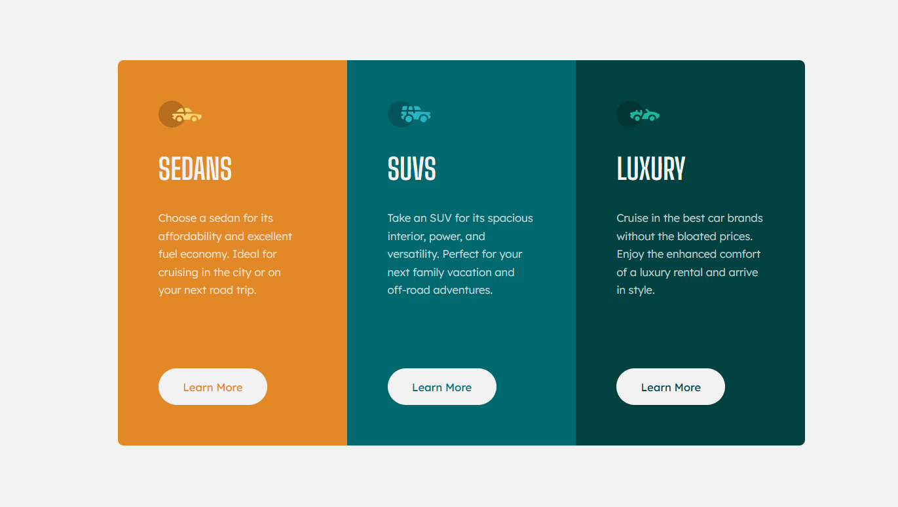

# Frontend Mentor - 3-column preview card component solution

This is a solution to the [3-column preview card component challenge on Frontend Mentor](https://www.frontendmentor.io/challenges/3column-preview-card-component-pH92eAR2-). Frontend Mentor challenges help you improve your coding skills by building realistic projects. 

## Table of contents

- [Overview](#overview)
  - [The challenge](#the-challenge)
  - [Screenshot](#screenshot)
  - [Links](#links)
- [My process](#my-process)
  - [Built with](#built-with)
  - [What I learned](#what-i-learned)
  - [Continued development](#continued-development)
  - [Useful resources](#useful-resources)
  - [AI Collaboration](#ai-collaboration)
- [Author](#author)
- [Acknowledgments](#acknowledgments)

## Overview

### The challenge

Users should be able to:

- View the optimal layout depending on their device's screen size
- See hover states for interactive elements

### Screenshot

## My process

### Built with

- Semantic HTML5 markup
- CSS custom properties
- Flexbox

### What I learned

While building this project, I practiced using Flexbox to arrange and center elements. I also learned how the flex property helps elements grow or shrink to fit the available space.

I explored CSS custom properties to make styles easier to maintain and began thinking more carefully about semantic HTML, accessibility, and responsive design.

### Continued development

I want to continue improving my understanding of Flexbox and its properties. I also plan to practice responsive design, semantic HTML, and accessibility in future projects.

### AI Collaboration

I used ChatGPT as a learning and code-review tool throughout this project. Rather than relying on AI to write the code for me, I used it to question my HTML markup and CSS decisions, review my implementation, and identify potential improvements.

This approach helped me understand the reasoning behind different design choices and develop my problem-solving skills.

## Author

- Frontend Mentor - [@haris-25](https://www.frontendmentor.io/profile/haris-25)
- GitHub - [@haris-25](https://www.github.com/haris-25)
